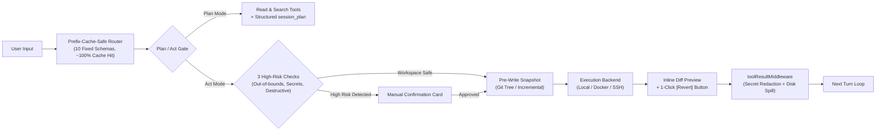

<div align="center">

<picture>
  <source media="(prefers-color-scheme: dark)" srcset="./assets/readme-hero-dark.png" />
  <source media="(prefers-color-scheme: light)" srcset="./assets/readme-hero-light.png" />
  
</picture>

# Aether

### High-conviction AI engineering. Local-first, zero slop.

A post-digital minimalist AI engineering workbench connecting empirical model evaluation, project workspace context, and controlled agent execution.

Prefix-cache-safe dual-layer routing, binary Plan/Act execution gates with instant pre-write rollbacks, and zero-disturbance invisible memory. Local-first storage, pluggable providers, and strict anti-AI-slop design.

[](https://github.com/TQSY114514/Aether/releases)
[](https://github.com/TQSY114514/Aether/releases)
[](https://www.npmjs.com/package/aetherai)
[](https://www.npmjs.com/package/aetherai)
[](https://github.com/TQSY114514/Aether/actions/workflows/ci.yml)
[](./LICENSE)
[](#1-windows-desktop-installation-primary-edition--recommended)

**[English](./README.md)** · [简体中文](./README.zh-CN.md) · [日本語](./README.ja.md)

</div>

---

## Overview

Aether is a local-first desktop AI development workbench built with Electron, React/TypeScript, and SQLite. Its central idea is to connect the critical stages of AI-assisted engineering: evaluating models on real tasks, carrying project context across sessions, and executing work through a reviewable, capability-gated agent workflow.

It is built around five complementary capabilities:

1. **Task-based model evaluation (Arena 2.0)**: Compare multiple models on identical coding tasks with concurrent streaming, empirical ELO leaderboards, and 1-click winner patch disk apply (`arena:apply-patch`).
2. **Workspace Hub & 3-Item Navigation**: First-class project workspace management with Git branch tracking, automatic project instructions discovery (`AGENTS.md`), native explorer integration, and project-scoped session filtering — organized cleanly across `Workspace`, `Arena`, and `Settings`.
3. **Prefix-Cache-Safe Two-Layer Tool Routing**: 10 fixed top-level schemas (`read_file`, `edit_file`, `write_file`, `grep_search`, `glob_files`, `run_command`, `ask_user`, `session_plan`, `dispatch_subagent`, `call_extended_tool`) that eliminate stage-switch prompt cache misses (~100% prefix cache reuse), backed by specialized subagent pools and secondary gateway calls (`call_extended_tool`).
4. **Binary Plan / Act Execution Gate & Pre-Write Snapshots**: Simple, decisive binary execution. `Plan` mode allows read-only exploration and structured plans; `Act` mode auto-executes workspace edits with zero confirmation fatigue, backed by pre-write Git-tree/incremental snapshots, inline red/green Diff cards, and 1-click revert. Manual confirmation is reserved strictly for 3 high-risk scenarios: out-of-workspace paths, credential files (`.env*`, `*.pem`, `*.key`), and destructive shell commands.
5. **AutoMemory Zero-Disturbance Invisibility**: SQLite WAL + FTS5 `< 2ms` zero-roundtrip prefetch. Unobtrusive `[Memory · X hits]` capsule in assistant headers, explainable Why-Injected popovers with 1-click AGENTS.md pinning (symlink traversal safe), and inline suggestions to distill recurring workflows into `SKILL.md`.

Aether is local-first: sessions, memories, evaluation data, and encrypted provider credentials are stored in the local SQLite database. When you use a hosted model provider, prompts, code, or context sent to that provider are still subject to its data-handling policies.

---

## Getting Started

> **Recommended Edition**: Aether's primary engineering focus and full feature set (side-by-side visual Arena, interactive Diff approval cards, Knowledge Graph visualization, and settings) live in the **Windows Desktop application**. For the complete experience, **we strongly recommend downloading the Windows Desktop edition**.

### 1. Windows Desktop Installation (Primary Edition · Recommended)

Download the latest release from [GitHub Releases](https://github.com/TQSY114514/Aether/releases):

- **`aetherai-setup-x.y.z.exe`**: Standard installer (includes desktop shortcuts and auto-update support; **recommended for most users**).
- **`aetherai-x.y.z.exe`**: Portable single-file executable (zero installation).

> **Note on Windows SmartScreen**: Aether is maintained by an independent developer without a commercial code-signing certificate. If Windows Defender displays *"Windows protected your PC"* on first launch, click **More info → Run anyway**.

### 2. Terminal TUI, Headless CLI & SDK (Companion Automation · Node.js ≥ 22)

Aether distributes a clean headless runtime, Ink v5 terminal TUI, and Electron-free SDK via npm (`aetherai`):

```bash
# Install CLI and TUI globally
npm install -g aetherai

# Launch interactive terminal TUI workbench (with history, diff previews & rollbacks)
aether tui

# Resume an existing conversation in the terminal
aether tui --session 42

# Execute a one-shot task from the command line
aether "run test suite and fix failing unit tests" --model deepseek

# Evaluate a prompt across models
aether eval "write a binary search in rust" --models claude-3-7-sonnet,deepseek-reasoner

# Start headless JSONL RPC server for external scripts and subagents
aether --mode rpc
```

### 3. Configuring LLM Providers

On first launch, open **Settings → Providers** in the sidebar to configure one or more API endpoints. Aether supports native OpenAI, Anthropic, and Gemini wire formats:

| Provider Option | Wire Format | Base URL Example | Typical Use Case |
| :--- | :--- | :--- | :--- |
| **DeepSeek API** | OpenAI-compatible | `https://api.deepseek.com/v1` | Low-cost, reliable daily coding and debugging |
| **OpenRouter** | OpenAI-compatible | `https://openrouter.ai/api/v1` | Access Claude, GPT, Gemini, and Qwen with a single key; ideal for **Arena** comparisons |
| **Ollama / LM Studio** | OpenAI-compatible | `http://127.0.0.1:11434/v1` | 100% offline local GPU inference with zero API cost |

### 4. Building from Source

```bash
git clone https://github.com/TQSY114514/Aether.git
cd Aether

# Windows: installs dependencies, builds frontend, and launches Electron
start.bat

# macOS / Linux: defaults to Terminal TUI; pass --desktop for Electron GUI
./start.sh
./start.sh --desktop
```

---

## Core Subsystems

### 1. AutoMemory · Structured Long-Term Memory & Project Brain

Instead of storing memories in a flat YAML/JSON file that requires full-file rewrites or manual `memory_search` tool calls, Aether implements a two-pass **Prefetch + Async Sync** pipeline backed by SQLite WAL, FTS5 full-text indexing, and a relational Knowledge Graph (`kg_nodes` / `kg_edges`):

- **Zero-Roundtrip Prefetch (`< 2ms`)**: Before sending a turn to the LLM, Aether queries the local FTS5 index and entity graph in memory, injecting relevant facts directly into the system prompt without spending an extra LLM tool-call roundtrip.
- **Debounced Background Sync**: After each turn completes, a background pass extracts new entities, technical decisions, and preferences, deduplicating entries via Jaccard similarity before persisting to SQLite.

#### Memory Types & Scoping

| Type (`type`) | Scope & Injection Policy | Examples |
| :--- | :--- | :--- |
| **`project` (Project Brain)** | Scoped to the active `workspace` directory; **always pinned at the top of context** | Repository architecture rules, build/test commands, module boundaries |
| **`preference`** | Global scope; injected on keyword/topic match | Code formatting rules, verbosity preferences, preferred libraries |
| **`fact`** | Global or workspace-scoped; retrieved via FTS5 keyword matching | Port numbers, environment conventions, verified domain rules |
| **`context`** | Cross-session summary index | Milestones from prior sessions, compacted long-conversation conclusions |
| **`review`** | Conflict resolution queue | Newly extracted statements that contradict existing memories |

#### Isolation & Safety Controls

1. **Automatic `AGENTS.md` Discovery**: When pointed at a project directory, Aether automatically detects and injects root `AGENTS.md` or `AETHER.md` files.
2. **Zero-Disturbance Invisibility & Transparent Provenance**: Memory management is completely invisible and zero-distraction. An unobtrusive `[Memory · X hits]` capsule appears in the assistant response header. Clicking it opens a lightweight popover displaying the exact injected memories and match reasons (`Why Injected`), with quick `[Remove]` and `[Pin to AGENTS.md]` actions (protected by canonical path realpath validation). When repetitive patterns are detected, an inline suggestion bar allows instant distillation into a `SKILL.md`.
3. **Fail-Closed Workspace Isolation (`getMemoriesScoped`)**: Project memories recorded in Repository A are strictly isolated from Repository B.
4. **Untrusted Memory Sandboxing (`<untrusted_memory>`)**: Memories originating from web fetches or external tools are tagged with `origin='external'`, capped in count, and wrapped in `<untrusted_memory>` tags so the model treats them as data rather than executable instructions.
5. **Memory-to-Skill Distillation (`memorySkillBridge`)**: Clusters recurring project memories into reusable draft `SKILL.md` templates.

---

### 2. Workspace Hub & Decluttered Desktop Workbench

Aether 2.0 establishes the Workspace as a first-class citizen, decoupling cross-project context and eliminating interface redundancy:

- **3-Item Primary Navigation**: Streamlined into `Workspace` (Main chat + inline Subagent Deck + inline Diff & 1-click Rollback + Split Run), `Arena` (empirical multi-model comparison), and `Settings` (unified Providers & MCP).
- **Sidebar Workspace Hub (`WorkspaceHeader.tsx`)**: Mounted prominently at the top of the sidebar, providing instant project switching, favorites (`⭐`), one-click Reveal in File Explorer, and terminal `cd` command copying.
- **Live Git & Rules Telemetry**: Automatically tracks the active Git branch and dirty working-tree state, and surfaces active project governance rules (`AGENTS.md`).
- **Project Scope Filter**: One-click toggling between "Current Project Sessions" and "All Sessions", keeping chat histories organized and unpolluted across separate codebases.
- **Unified 4-Control Composer HUD**: Per-turn execution controls are consolidated directly below the input prompt: `[Plan / Act Mode]`, `[Model Selector]`, `[EffortControl Reasoning Depth]`, and `[Session Tokens & Quick Pre-Write Rollback]`. No visual clutter or duplicate buttons.

---

### 3. Arena 2.0 · Empirical Multi-Model Evaluation & Winner Patch Apply

The built-in Arena allows side-by-side evaluation on your actual workload, closing the loop from blind comparison to production disk apply:

| Feature | Mechanism |
| :--- | :--- |
| **Concurrent Blind Streaming** | Dispatch a single prompt to 2–4 models (or compare different temperatures / system prompts on the same model) with real-time side-by-side streaming. |
| **Intent-Categorized ELO** | Prompts are classified by intent (`Coding`, `Reasoning`, `Translation`). Votes update separate local ELO leaderboards per category. |
| **Starter Benchmark Suite** | Built-in automated evaluation suite (`arenaStarterBenchmark.js`) covering algorithmic reasoning, system design, and debugging tasks to systematically score latency, token costs, and accuracy. |
| **Winner Patch Disk Apply** | After evaluating candidates in blind competition, click once to apply the winning model's diff cleanly into your local repository (`arena:apply-patch`). |
| **Report Export** | Export side-by-side comparison results as structured Markdown reports or summary cards. |

---

### 4. Binary Plan / Act Execution Gate & Pre-Write Snapshots

Aether replaces complex permission matrices with a decisive, low-friction binary execution model (`Plan` vs `Act`) backed by instant rollbacks:

| Mode | Enforcement Behavior | Typical Scenario |
| :--- | :--- | :--- |
| **`Plan` (Read-Only Planning)** | Blocks all file modifications and state-mutating shell commands. Allows codebase reading, grep/glob search, read-only Git exploration, and outputs structured `session_plan` milestones. | Architecture review, task scoping, dependency discovery |
| **`Act` (Autonomous Action)** | Automatically executes workspace reads, edits, writes, and test commands **without modal interruptions**. Every turn that touches files captures a pre-write snapshot (`git stash create` or `.aether/snapshots/<turnId>`), renders an inline red/green Diff, and provides a 1-click `[Revert]` button. | Active feature development, bug fixes, refactoring |

#### 3 High-Risk Interception Gates (Act Mode)

Act mode runs autonomously inside the project workspace, but halts execution and prompts for explicit confirmation in only 3 strictly audited scenarios:
1. **Out-of-Workspace Paths**: Any attempt to read or write files outside the workspace root.
2. **Sensitive Credentials**: Any modification to credential files (`.env*`, `*.pem`, `*.key`).
3. **Destructive Shell Commands**: Execution of dangerous commands (e.g. `rm -rf`, `git reset --hard`, `git push --force`, or unverified script pipe execution).



---

### 5. Adaptive Thinking Depth, Hashline Edits & Runtime Resilience

- **5-Tier Adaptive Thinking Depth (Thinking Budget)**: Per-turn control over reasoning budgets (`minimal 1k`, `low 2k`, `medium 8k`, `high 16k`, `max 32k tokens`), natively supporting token-budget models (Claude 3.7 Sonnet, DeepSeek R1, Qwen-Reasoner) and boolean-toggle models (`enable_thinking`).
- **Hashline Hash-Anchored Code Editing**: Incorporates content-hash line anchoring into `patchEngine.js`, preventing line drift and merge collisions across concurrently edited files.
- **Prefix-Cache-Safe Two-Layer Tool Router**: Instead of dynamically mutating tool schemas across phases (which invalidates API prompt prefix caches on every turn), Aether pins 10 fixed top-level tool schemas to guarantee near 100% prefix cache reuse. Specialized roles (`Explorer`, `Implementer`, `Verifier`) receive targeted subagent pools via `dispatch_subagent`, and auxiliary tools are dispatched through `call_extended_tool` with a compact catalog index.
- **Orphan Tool-Call Self-Healing**: Automatically sanitizes unclosed `tool_calls` on session reload so a previously interrupted tool execution never poisons subsequent turns with HTTP 400 errors.
- **Live Cost & Iteration Circuit Breaker**: The status bar displays current iteration count, estimated turn tokens, cumulative USD cost, and stops execution automatically if a user-defined budget cap is reached.

---

### 6. Extensibility: Skills, MCP, and Execution Backends

- **Skills (`SKILL.md`)**: Import or author modular skills with declarative `permissions:` frontmatter (`filesystem`, `network`, `shell`) enforced by the permission engine.
- **MCP (Model Context Protocol)**: Connect external stdio MCP servers with automatic `server__tool` namespacing to prevent tool name collisions. All MCP outputs pass through `toolResultMiddleware`.
- **Pluggable Execution Backends**: Switch command execution between **Local Host (`local`)**, **Docker Container Sandbox (`docker`)**, and **Remote SSH (`ssh`)**.

---

## Acknowledgements

Aether stands on the shoulders of these open-source projects and engineering pioneers (traced to the codebase modules they inspired):

### Agent Runtime & Coding Harnesses
- **[Claude Code](https://claude.ai/code) (Anthropic)** — Cascading `AGENTS.md` instruction discovery (`projectInstructions.js`), post-compaction file rehydration (`compaction.js`), verification loop (`debugAgent.js`), 10-point lifecycle hooks (`hooks.js`), progressive permission ladder (`trustEngine.js`), `Ctrl+T` task checklist, `ask_user` prompts, and inline Diff previews (`toolImpact.js`).
- **[OpenAI Codex CLI](https://github.com/openai/codex)** — Evidence-based test/diff verification (`toolLoop.js`), cascading project instruction loading, compact TUI elapsed timers, single-key permission shortcuts (`y/s/a/n`), and checkpoint rewind UX.
- **[pi (`pi-mono`)](https://github.com/badlogic/pi-mono) (Mario Zechner)** — `AgentMessage` UI-to-wire decoupling (`agentMessage.js`), unified event-stream telemetry (`agentEvents.js`), mid-execution steering (`steering.js`), and large-output disk spill to `$TMPDIR` with tail preview (`toolResultMiddleware.js`).
- **[OpenCode](https://github.com/sst/opencode)** — Terminal TUI keyboard state machine & timed leader keys (`keyHandlers.js`), windowed `DialogSelect` lists, compile-time prompt cache policy (`cachePolicy.js`), and context budget manager (`contextBudget.js`).
- **[oh-my-pi (`omp`)](https://github.com/can1357/oh-my-pi) & [roboomp](https://github.com/roboomp)** — Terminal AI coding harness, automated triage & PR workflows, hash-anchored edits (`patchEngine.js` Hashline Edits) preventing concurrent clobbering and line drift, symbol-aware LSP/DAP code intelligence, and isolated multi-worktree subagent orchestration.
- **[Aider](https://github.com/Aider-AI/aider)** — `<<<<<<< SEARCH ... >>>>>>> REPLACE` fault-tolerant patch parser (`patchEngine.js`), Git workflow integration, and compaction handoff framing.
- **[ZCode](https://github.com/zai-org/ZCode) (Z.ai)** — 8-tier cascading fuzzy edit matchers (`editMatchers.js`), read-before-write file `mtime` freshness guard (`sessionContext.js`), background task `branchGeneration` isolation & notification coalescing (`backgroundTasks.js`), built-in agent & workflow profiles (`.aether/agents`, `.aether/workflows`), and GitHub URL / `owner/repo` skill installer (`skills.js`).
- **[Gemini CLI](https://github.com/google-gemini/gemini-cli) & [aichat](https://github.com/sigoden/aichat)** — Token budget estimation (`contextBudget.js`), approval mode cycling, and 50ms event-stream debounce coalescing (`runSession.js`).
- **[Cline](https://github.com/cline/cline), [Roo Code](https://github.com/RooVetGit/Roo-Code) & [Continue](https://github.com/continuedev/continue)** — Context output folding/pruning (`compaction.js`), visible sub-step task tracking, and declarative configuration-as-code schema (`.aether/config.json`).
- **[Search](https://github.com/driceroland/Search) (`driceroland/Search`)** — Multi-granularity local repository search & context-aware code retrieval ergonomics (`registry.js`, `repoMap.js`).

### Context, Memory & Safety Mechanisms
- **[OpenClaw](https://github.com/openclaw/openclaw)** — Context compaction planning (`compaction.js`), malformed tool-call auto-repair (`toolCallRepair.js`), read-only tool caching (`toolCache.js`), semantic loop hash detection (`toolResultHash.js`), and secret-redacting tool result middleware (`toolResultMiddleware.js`).
- **[Hermes Agent](https://github.com/NousResearch/hermes-agent)** — Iteration budget control & graceful wrap-up (`iterationBudget.js`), SQLite + FTS5 long-term memory (`autoMemory.js`), entity-relationship Knowledge Graph (`knowledgeGraph.js`), trajectory compression (`trajectory.js`), and long-term skill acquisition (`habitLearner.js`).
- **[Wish](https://github.com/WindustH/wish-core) (WindustH)** — Zero-token MCP/Skill CLI bridge architecture for prompt cache protection, Windows Win32 Job Object kernel process tree lifecycle governance, and fetch-based resilient stream state machine.
- **[DeepSeek Harness (DSH)](https://github.com/deepseek-ai/deepseek-harness)** — Loopback binding & HTTP Host header validation lessons (QVD-2026-57410 defense) and badge row visual conventions.
- **[Open Math Harness](https://github.com/openmathmodel/open-math-harness) (SAIR Foundation)** — Microkernel architectural invariant guards & headless isolation (`architecture.rs` principles inspiring `check-architecture.js` static gates and Electron-free `database.js` decoupling).

### Evaluation, Code Review & Multi-Agent Orchestration
- **[Qwen Code](https://github.com/QwenLM/qwen-code) & [Qwen-Coder](https://github.com/QwenLM/Qwen3-Coder)** (Alibaba Cloud) — Agent Arena multi-model competitive execution & Git worktree isolation (`/arena` inspiring `shadowGit.js` and `arena:apply-patch`), `qwencoder-eval` benchmarking methodology, and thinking parameter adaptation (`enable_thinking` in `reasoning.js`).
- **[LMSYS Chatbot Arena](https://chat.lmsys.org/) & [SWE-bench](https://www.swebench.com/)** — Built-in local model arena (`arena.handler.js`), pairwise blind ELO ranking system, and coding capability evaluation harnesses.
- **[Paperclip](https://github.com/paperclipai/paperclip)** — Agent control-plane governance (`AgentSettings.tsx`), role-isolated multi-agent verification (`Hunter != Verifier` in `securityAudit.js`, `agentRoles.js`), and autonomous plan step progression (`planning.js`).
- **[OpenHands](https://github.com/All-Hands-AI/OpenHands) (All-Hands AI)** — Multi-backend execution abstractions (`backend.js`, `dockerBackend.js`, `sshBackend.js`) and persistent subagent sandbox workflows.
- **[Jules](https://jules.google.com)** (Google Labs), **[Grok Build](https://x.ai)**, **[Amp](https://ampcode.com)** & **[Devin Desktop (Windsurf)](https://windsurf.com)** — Asynchronous background coding agents, specialized sub-agent role profiles (`agentRoles.js`), long-running execution state machine (`longRunningTask.js`), and run timeline drawer concepts.
- **[Kiro](https://aws.amazon.com/q/developer/)** — Adaptive reasoning level controls (`reasoning.js` / `EffortControl.tsx`) and inline subagent execution visualization (`SubagentDeck.tsx`).
- **[DS4](https://gist.github.com/antirez) (Salvatore Sanfilippo)** & **[Evolver](https://github.com/EvoMap/evolver)** — Pre-execution hierarchical task decomposition (`planning.js`) and Genome Evolution Protocol (GEP) strategy reflection.
- **[CodeRabbit](https://coderabbit.ai) & [Greptile](https://greptile.com) ([`greptile-apps[bot]`](https://github.com/apps/greptile-apps))** — Automated PR-level line-by-line review, AST-aware unsafe API interception (`.coderabbit.yaml`), and repository-wide architectural semantic graph regression defense.

### Core Infrastructure & UI Ecosystem
- **Runtime & Storage**: [Electron](https://www.electronjs.org) · [better-sqlite3](https://github.com/WiseLibs/better-sqlite3) (Joshua Wise) · [Ink v5](https://github.com/vadimdemedes/ink) (Vadim Demedes) · [React](https://react.dev) · [Zustand](https://github.com/pmndrs/zustand) (Poimandres) · [Tailwind CSS](https://tailwindcss.com).
- **Components & Protocols**: [Model Context Protocol (MCP)](https://modelcontextprotocol.io) · [shadcn/ui](https://github.com/shadcn-ui/ui) · [Magic UI](https://github.com/magicuidesign/magicui) · [cc-switch](https://github.com/farion1231/cc-switch) · [new-api](https://github.com/QuantumNous/new-api).

---

## Contributing & License

- **Bug Reports & Feature Requests**: Submit via [GitHub Issues](https://github.com/TQSY114514/Aether/issues/new).
- **Development Guidelines**: Review [CONTRIBUTING.md](./CONTRIBUTING.md), [AGENTS.md](./AGENTS.md), and [docs/roadmap.md](./docs/roadmap.md) before submitting pull requests.
- **License**: [MIT](./LICENSE) (see [THIRD-PARTY-NOTICES.md](./THIRD-PARTY-NOTICES.md) for third-party attributions) © 2025-2026 Aether
