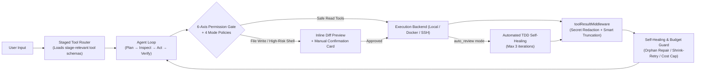
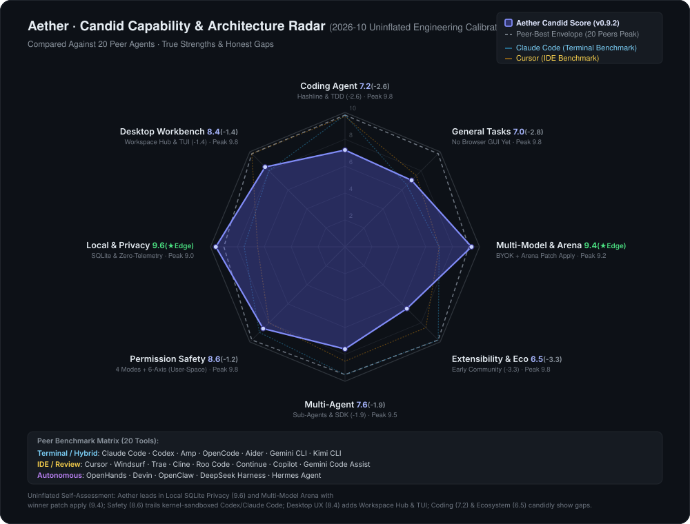

<div align="center">

<picture>
  <source media="(prefers-color-scheme: dark)" srcset="./assets/readme-hero-dark.png" />
  <source media="(prefers-color-scheme: light)" srcset="./assets/readme-hero-light.png" />
  
</picture>

# Aether

### Test models on your work. Put the results to work.

An evidence-driven AI development workbench connecting model evaluation, project workspace context, and controlled agent execution.

Compare models on real coding tasks, inspect the results, and use that evidence to inform your workflow. Local-first storage, provider flexibility, and capability-gated execution help keep your work under your control.

[](https://github.com/TQSY114514/Aether/releases)
[](https://github.com/TQSY114514/Aether/releases)
[](https://www.npmjs.com/package/aetherai)
[](https://www.npmjs.com/package/aetherai)
[](https://github.com/TQSY114514/Aether/actions/workflows/ci.yml)
[](./LICENSE)
[](#1-windows-desktop-installation-primary-edition--recommended)

**[English](./README.md)** · [简体中文](./README.zh-CN.md) · [日本語](./README.ja.md) · [20-Peer Competitive Matrix](./docs/competitive-analysis.md)

</div>

---

## Overview

Aether is a local-first desktop AI development workbench built with Electron, React/TypeScript, and SQLite. Its central idea is to connect the critical stages of AI-assisted engineering: evaluating models on real tasks, carrying project context across sessions, and executing work through a reviewable, capability-gated agent workflow.

It is built around five complementary capabilities:

1. **Task-based model evaluation (Arena 2.0)**: Compare multiple models on identical coding tasks, inspect streaming outputs, and gather preference or evaluation signals. Winner patches can be applied directly to your working tree in one click.
2. **Workspace Hub**: First-class project workspace management with Git branch tracking, project instructions discovery (`AGENTS.md` / `AETHER.md`), system-native file explorer integration, and project-scoped session filtering.
3. **Evidence-informed model selection & adaptive reasoning**: Model advice and routing use task categories and available Arena scores; 5-tier adaptive thinking budgets (`1k` to `32k` tokens) provide granular control over reasoning depth.
4. **Project context and long-term memory**: AutoMemory, Project Brain, and repository mapping preserve relevant facts and architectural context across sessions with `< 2ms` zero-roundtrip prefetching.
5. **Controlled agent execution & Hashline edits**: Four explicit operating modes (`explore`, `workspace`, `auto_review`, `unrestricted`) backed by a six-axis permission gate (`READ`, `WRITE`, `EXECUTE`, `NETWORK`, `GIT`, `EXTERNAL`), content-hash-anchored editing against line drift, and supervised TDD self-healing loops.

Aether is local-first: sessions, memories, evaluation data, and encrypted provider credentials are stored in the local SQLite database. When you use a hosted model provider, prompts, code, or context sent to that provider are still subject to its data-handling policies.

---

## Getting Started

> **Recommended Edition**: Aether's primary engineering focus and full feature set (side-by-side visual Arena, interactive Diff approval cards, Knowledge Graph visualization, and settings) live in the **Windows Desktop application**. For the complete experience, **we strongly recommend downloading the Windows Desktop edition**.

### 1. Windows Desktop Installation (Primary Edition · Recommended)

Download the latest release from [GitHub Releases](https://github.com/TQSY114514/Aether/releases):

- **`aetherai-setup-x.y.z.exe`**: Standard installer (includes desktop shortcuts and auto-update support; **recommended for most users**).
- **`aetherai-x.y.z.exe`**: Portable single-file executable (zero installation).

> **Note on Windows SmartScreen**: Aether is maintained by an independent developer without a commercial code-signing certificate. If Windows Defender displays *"Windows protected your PC"* on first launch, click **More info → Run anyway**.

### 2. Terminal TUI, Headless CLI & SDK (Companion Automation · Node.js ≥ 22)

Aether distributes a clean headless runtime, Ink v5 terminal TUI, and Electron-free SDK via npm (`aetherai`):

```bash
# Install CLI and TUI globally
npm install -g aetherai

# Launch interactive terminal TUI workbench (with history, diff previews & rollbacks)
aether tui

# Resume an existing conversation in the terminal
aether tui --session 42

# Execute a one-shot task from the command line
aether "run test suite and fix failing unit tests" --model deepseek

# Evaluate a prompt across models
aether eval "write a binary search in rust" --models claude-3-7-sonnet,deepseek-reasoner

# Start headless JSONL RPC server for external scripts and subagents
aether --mode rpc
```

### 3. Configuring LLM Providers

On first launch, open **Settings → Providers** in the sidebar to configure one or more API endpoints. Aether supports native OpenAI, Anthropic, and Gemini wire formats:

| Provider Option | Wire Format | Base URL Example | Typical Use Case |
| :--- | :--- | :--- | :--- |
| **DeepSeek API** | OpenAI-compatible | `https://api.deepseek.com/v1` | Low-cost, reliable daily coding and debugging |
| **OpenRouter** | OpenAI-compatible | `https://openrouter.ai/api/v1` | Access Claude, GPT, Gemini, and Qwen with a single key; ideal for **Arena** comparisons |
| **Ollama / LM Studio** | OpenAI-compatible | `http://127.0.0.1:11434/v1` | 100% offline local GPU inference with zero API cost |

### 4. Building from Source

```bash
git clone https://github.com/TQSY114514/Aether.git
cd Aether

# Windows: installs dependencies, builds frontend, and launches Electron
start.bat

# macOS / Linux: defaults to Terminal TUI; pass --desktop for Electron GUI
./start.sh
./start.sh --desktop
```

---

## Core Subsystems

### 1. AutoMemory · Structured Long-Term Memory & Project Brain

Instead of storing memories in a flat YAML/JSON file that requires full-file rewrites or manual `memory_search` tool calls, Aether implements a two-pass **Prefetch + Async Sync** pipeline backed by SQLite WAL, FTS5 full-text indexing, and a relational Knowledge Graph (`kg_nodes` / `kg_edges`):

- **Zero-Roundtrip Prefetch (`< 2ms`)**: Before sending a turn to the LLM, Aether queries the local FTS5 index and entity graph in memory, injecting relevant facts directly into the system prompt without spending an extra LLM tool-call roundtrip.
- **Debounced Background Sync**: After each turn completes, a background pass extracts new entities, technical decisions, and preferences, deduplicating entries via Jaccard similarity before persisting to SQLite.

#### Memory Types & Scoping

| Type (`type`) | Scope & Injection Policy | Examples |
| :--- | :--- | :--- |
| **`project` (Project Brain)** | Scoped to the active `workspace` directory; **always pinned at the top of context** | Repository architecture rules, build/test commands, module boundaries |
| **`preference`** | Global scope; injected on keyword/topic match | Code formatting rules, verbosity preferences, preferred libraries |
| **`fact`** | Global or workspace-scoped; retrieved via FTS5 keyword matching | Port numbers, environment conventions, verified domain rules |
| **`context`** | Cross-session summary index | Milestones from prior sessions, compacted long-conversation conclusions |
| **`review`** | Conflict resolution queue | Newly extracted statements that contradict existing memories |

#### Isolation & Safety Controls

1. **Automatic `AGENTS.md` Discovery**: When pointed at a project directory, Aether automatically detects and injects root `AGENTS.md` or `AETHER.md` files.
2. **Transparent Provenance (`Why Injected`)**: Whenever a memory is injected into a conversation turn, the UI displays which memory entries were used and why they matched. Users can inspect, edit, deduplicate (`dedupe`), or delete entries in the **Memory** view.
3. **Fail-Closed Workspace Isolation (`getMemoriesScoped`)**: Project memories recorded in Repository A are strictly isolated from Repository B.
4. **Untrusted Memory Sandboxing (`<untrusted_memory>`)**: Memories originating from web fetches or external tools are tagged with `origin='external'`, capped in count, and wrapped in `<untrusted_memory>` tags so the model treats them as data rather than executable instructions.
5. **Memory-to-Skill Distillation (`memorySkillBridge`)**: Clusters recurring project memories into reusable draft `SKILL.md` templates.

---

### 2. Workspace Hub & Decluttered Desktop Workbench

Aether 2.0 establishes the Workspace as a first-class citizen, decoupling cross-project context and eliminating interface redundancy:

- **Sidebar Workspace Hub (`WorkspaceHeader.tsx`)**: Mounted prominently at the top of the sidebar, providing instant project switching, favorites (`⭐`), one-click Reveal in File Explorer, and terminal `cd` command copying.
- **Live Git & Rules Telemetry**: Automatically tracks the active Git branch and dirty working-tree state, and surfaces active project governance rules (`AGENTS.md`).
- **Project Scope Filter**: One-click toggling between "Current Project Sessions" and "All Sessions", keeping chat histories organized and unpolluted across separate codebases.
- **Single Authoritative Home Layout**: Per-turn execution controls (Model selector, Agent mode, Thinking depth) live strictly in the prompt composer toolbar; system-wide diagnostic readiness (SQLite WAL, active MCP servers, local gateway port) is unified into a sleek, non-intrusive status capsule at the sidebar footer.

---

### 3. Arena 2.0 · Empirical Multi-Model Evaluation & Winner Patch Apply

The built-in Arena allows side-by-side evaluation on your actual workload, closing the loop from blind comparison to production disk apply:

| Feature | Mechanism |
| :--- | :--- |
| **Concurrent Blind Streaming** | Dispatch a single prompt to 2–4 models (or compare different temperatures / system prompts on the same model) with real-time side-by-side streaming. |
| **Intent-Categorized ELO** | Prompts are classified by intent (`Coding`, `Reasoning`, `Translation`). Votes update separate local ELO leaderboards per category. |
| **Starter Benchmark Suite** | Built-in automated evaluation suite (`arenaStarterBenchmark.js`) covering algorithmic reasoning, system design, and debugging tasks to systematically score latency, token costs, and accuracy. |
| **Winner Patch Disk Apply** | After evaluating candidates in blind competition, click once to apply the winning model's diff cleanly into your local repository (`arena:apply-patch`). |
| **Report Export** | Export side-by-side comparison results as structured Markdown reports or summary cards. |

---

### 4. 4-Tier Operating Modes & 6 Capability Axes

Permissions are evaluated independently across six axes (`READ`, `WRITE`, `EXECUTE`, `NETWORK`, `GIT`, `EXTERNAL`) under four explicit operating modes:

| Mode | Enforcement Behavior | Typical Scenario |
| :--- | :--- | :--- |
| **`explore` (Read-Only)** | Blocks all file writes and mutating shell commands; the agent inspects, searches, and analyzes code safely. | Architecture review, codebase exploration, impact analysis |
| **`workspace` (Default)** | Read tools run automatically; file edits display an inline red/green Diff and commands outside the workspace require confirmation. | Daily pair programming, refactoring, and feature work |
| **`auto_review` (TDD Loop)** | Supervised test-driven development: automatically runs test suites after editing code and self-heals failures (up to 3 bounded repair loops). | Automated unit testing and self-healing bug fixes |
| **`unrestricted` (Full Sandbox)** | Approves all operations automatically with background security guards (recommended with the Docker execution backend). | Sandboxed autonomous long-running tasks |



---

### 5. Adaptive Thinking Depth, Hashline Edits & Runtime Resilience

- **5-Tier Adaptive Thinking Depth (Thinking Budget)**: Per-turn control over reasoning budgets (`minimal 1k`, `low 2k`, `medium 8k`, `high 16k`, `max 32k tokens`), natively supporting token-budget models (Claude 3.7 Sonnet, DeepSeek R1, Qwen-Reasoner) and boolean-toggle models (`enable_thinking`).
- **Hashline Hash-Anchored Code Editing**: Incorporates content-hash line anchoring into `patchEngine.js`, preventing line drift and merge collisions across concurrently edited files.
- **Staged Tool Router**: Dynamically injects only the tool schemas relevant to the current task phase (`Diagnose → Search → Edit → Verify`) out of 42+ built-in and MCP tools, reducing prompt token overhead by ~40%.
- **Orphan Tool-Call Self-Healing**: Automatically sanitizes unclosed `tool_calls` on session reload so a previously interrupted tool execution never poisons subsequent turns with HTTP 400 errors.
- **Live Cost & Iteration Circuit Breaker**: The status bar displays current iteration count, estimated turn tokens, cumulative USD cost, and stops execution automatically if a user-defined budget cap is reached.

---

### 6. Extensibility: Skills, MCP, and Execution Backends

- **Skills (`SKILL.md`)**: Import or author modular skills with declarative `permissions:` frontmatter (`filesystem`, `network`, `shell`) enforced by the permission engine.
- **MCP (Model Context Protocol)**: Connect external stdio MCP servers with automatic `server__tool` namespacing to prevent tool name collisions. All MCP outputs pass through `toolResultMiddleware`.
- **Pluggable Execution Backends**: Switch command execution between **Local Host (`local`)**, **Docker Container Sandbox (`docker`)**, and **Remote SSH (`ssh`)**.

---

## Honest Positioning (20-Peer Radar Comparison)

Aether avoids inflated "all-10/10" marketing charts. Our genuine strengths are **Local SQLite Data Ownership (`9.6/10`)** and **Multi-Model BYOK + Built-in ELO Arena & Winner Patch Apply (`9.4/10`)**. On **Desktop Workbench UX (`8.4/10`)**, Aether provides a focused, decluttered workspace (Workspace Hub, live streaming reasoning, BTW side questions, Ink v5 terminal TUI, and Single Authoritative Home layout), while candidly trailing deep editor forks like Cursor (`9.8`) and Windsurf (`9.6`). On **Permission Safety (`8.6/10`)**, Aether enforces 4 agent modes, a 6-axis permission gate, Win32 Job Object process governance, and optional Docker sandboxing, but trails OS-kernel-sandboxed tools like Codex CLI (`9.8`) and Claude Code (`9.0`) when running in default Windows user-space (`localBackend`). On **Multi-Agent Orchestration (`7.6/10`)**, Aether provides task-journal subagents, crash recovery, and an Electron-free SDK. On **Single-Model Coding Depth (`7.2/10`)** (reinforced by Hashline hash-anchored editing and TDD auto-review) and **Early-Stage Community Ecosystem (`6.5/10`)**, the chart candidly depicts our honest gap behind commercial giants (generated via `node app/scripts/gen-radar.cjs`):

<div align="center">
  
</div>

For the complete scoring breakdown, explicit engineering limitations, and 20-peer comparison matrix, see [docs/competitive-analysis.md](./docs/competitive-analysis.md).

---

## Acknowledgements

Aether stands on the shoulders of these open-source projects and engineering pioneers (traced directly to the codebase modules they inspired):

### Agent Frameworks & Runtime Mechanisms
- **[Claude Code](https://claude.ai/code) (Anthropic)** — Verification test loop (`debugAgent.js`), 10-point lifecycle hook system (`hooks.js`), progressive permission ladder (`trustEngine.js`), `Ctrl+T` task checklist panel, `ask_user` structured prompts, and inline file Diff previews (`toolImpact.js`).
- **[OpenClaw](https://github.com/openclaw/openclaw)** — Context compaction planning (`compaction.js`), malformed tool-call auto-repair (`toolCallRepair.js`), read-only tool caching (`toolCache.js`), semantic loop hash detection (`toolResultHash.js`), and secret-redacting tool result middleware (`toolResultMiddleware.js`).
- **[Hermes Agent](https://github.com/NousResearch/hermes-agent)** — Iteration budget control & graceful wrap-up (`iterationBudget.js`), SQLite + FTS5 long-term memory (`autoMemory.js`), entity-relationship Knowledge Graph (`knowledgeGraph.js`), trajectory compression (`trajectory.js`), and long-term skill acquisition (`habitLearner.js`).
- **[OpenCode](https://github.com/sst/opencode)** — Terminal TUI keyboard state machine & timed leader keys (`keyHandlers.js`), windowed `DialogSelect` lists, compile-time prompt cache policy (`cachePolicy.js`), and context budget manager (`contextBudget.js`).
- **[pi (`pi-mono`)](https://github.com/badlogic/pi-mono) (Mario Zechner)** — `AgentMessage` UI-to-wire decoupling (`agentMessage.js`), unified event-stream telemetry (`agentEvents.js`), and mid-execution steering (`steering.js`).
- **[ZCode](https://github.com/zai-org/ZCode) (Z.ai)** — 8-tier cascading fuzzy edit matchers (`editMatchers.js`), read-before-write file `mtime` freshness guard (`sessionContext.js`), two-tier zero-LLM-cost local microcompaction (`microcompact.js`), background task `branchGeneration` isolation & notification coalescing (`backgroundTasks.js`), built-in agent & workflow profiles (`.aether/agents`, `.aether/workflows`), and GitHub URL / `owner/repo` skill installer (`skills.js`).
- **[Paperclip](https://github.com/paperclipai/paperclip)** — Agent control-plane governance (`AgentSettings.tsx`), role-isolated multi-agent verification (`Hunter != Verifier` in `securityAudit.js`, `agentRoles.js`), and autonomous plan step progression & completion finalization (`planning.js`).
- **[Search](https://github.com/driceroland/Search) (`driceroland/Search`)** — Multi-granularity local repository search & context-aware code retrieval ergonomics (`registry.js`, `repoMap.js`).
- **[OpenAI Codex CLI](https://github.com/openai/codex)** — Evidence-based test/diff verification (`toolLoop.js`), compact TUI elapsed timers, single-key permission shortcuts (`y/s/a/n`), and checkpoint rewind UX.
- **[Aider](https://github.com/Aider-AI/aider)** — `<<<<<<< SEARCH ... >>>>>>> REPLACE` fault-tolerant patch parser (`patchEngine.js`), Git workflow integration, and compaction handoff framing.
- **[Cline](https://github.com/cline/cline) & [Roo Code](https://github.com/RooVetGit/Roo-Code)** — Context output folding/pruning (`compaction.js`) and visible sub-step task tracking.
- **[Gemini CLI](https://github.com/google-gemini/gemini-cli) & [aichat](https://github.com/sigoden/aichat)** — Token budget estimation (`contextBudget.js`), approval mode cycling, and `aichat`'s 50ms event-stream debounce coalescing (`runSession.js`).
- **[Evolver](https://github.com/EvoMap/evolver)** — Genome Evolution Protocol (GEP) strategy reflection architecture.
- **[DS4](https://gist.github.com/antirez) (Salvatore Sanfilippo)** — Pre-execution hierarchical task decomposition (`planning.js`).
- **[Continue](https://github.com/continuedev/continue)** — Declarative configuration-as-code schema (`.aether/config.json`).
- **[Grok Build](https://x.ai), [Amp](https://ampcode.com) & [Devin Desktop (Windsurf)](https://windsurf.com)** — Specialized sub-agent role profiles (`agentRoles.js`), long-running execution state machine (`longRunningTask.js`), and run timeline drawer concepts.
- **[DeepSeek Harness (DSH)](https://github.com/deepseek-ai/deepseek-harness)** — Loopback binding & HTTP Host header validation lessons (QVD-2026-57410 defense) and badge row visual conventions.
- **[Qwen Code](https://github.com/QwenLM/qwen-code) & [Qwen-Coder](https://github.com/QwenLM/Qwen3-Coder)** (Alibaba Cloud) — Agent Arena multi-model competitive execution & Git worktree isolation architecture (`/arena` inspiring `shadowGit.js` shadow workspace sandboxing, concurrent model dispatch, and `arena:apply-patch` winner patch apply), `qwencoder-eval` benchmarking methodology, thinking parameter adaptation (`enable_thinking` in `reasoning.js`), and long-range coding benchmarks.
- **[Jules](https://jules.google.com)** (Google Labs) — Autonomous asynchronous background coding agent, cloud sandbox-isolated Issue-to-PR automation, and multi-task hosted orchestration.
- **[oh-my-pi (`omp`)](https://github.com/can1357/oh-my-pi) & [roboomp](https://github.com/roboomp)** — Terminal AI coding agent harness, roboomp automated triage & PR agent, hash-anchored edits (Hashline Edits in `patchEngine.js`) preventing concurrent clobbering and line drift, symbol-aware LSP/DAP code intelligence, and isolated multi-worktree subagent orchestration.
- **[CodeRabbit](https://coderabbit.ai) & [Greptile](https://greptile.com) ([`greptile-apps[bot]`](https://github.com/apps/greptile-apps))** — Automated PR-level line-by-line review, AST-aware unsafe API interception (`.coderabbit.yaml`), and repository-wide architectural semantic graph regression defense.
- **[Open Math Harness](https://github.com/openmathmodel/open-math-harness) (SAIR Foundation)** — Microkernel architectural invariant guards & headless isolation (`architecture.rs` static analysis principles inspiring the 5-gate `check-architecture.js` suite, headless decoupling of `database.js` from Electron, and ground-truth tree-search validation).
- **[LMSYS Chatbot Arena](https://chat.lmsys.org/) & [SWE-bench](https://www.swebench.com/)** — Built-in local model arena (`arena.handler.js`), pairwise blind ELO ranking system, and coding capability evaluation harnesses.
- **[OpenHands](https://github.com/All-Hands-AI/OpenHands) (All-Hands AI)** — Multi-backend execution abstractions (`backend.js`, `dockerBackend.js`, `sshBackend.js`) and persistent subagent sandbox workflows.
- **[Kiro](https://aws.amazon.com/q/developer/)** — Adaptive reasoning level controls (budget-based thinking vs binary toggle in `reasoning.js` / `EffortControl.tsx`) and inline subagent execution visualization (`SubagentDeck.tsx`).
- **[Wish](https://github.com/WindustH/wish-core) (WindustH)** — Zero-token MCP/Skill CLI bridge architecture for prompt cache protection, Windows Win32 Job Object kernel process tree lifecycle governance, and fetch-based resilient stream state machine.

### Core Infrastructure & UI Ecosystem
- **Runtime & Storage**: [Electron](https://www.electronjs.org) · [better-sqlite3](https://github.com/WiseLibs/better-sqlite3) (Joshua Wise) · [Ink v5](https://github.com/vadimdemedes/ink) (Vadim Demedes) · [React](https://react.dev) · [Zustand](https://github.com/pmndrs/zustand) (Poimandres) · [Tailwind CSS](https://tailwindcss.com).
- **Components & Protocols**: [Model Context Protocol (MCP)](https://modelcontextprotocol.io) · [shadcn/ui](https://github.com/shadcn-ui/ui) · [Magic UI](https://github.com/magicuidesign/magicui) · [cc-switch](https://github.com/farion1231/cc-switch) · [new-api](https://github.com/QuantumNous/new-api).

---

## Contributing & License

- **Bug Reports & Feature Requests**: Submit via [GitHub Issues](https://github.com/TQSY114514/Aether/issues/new).
- **Development Guidelines**: Review [CONTRIBUTING.md](./CONTRIBUTING.md), [AGENTS.md](./AGENTS.md), and [docs/roadmap.md](./docs/roadmap.md) before submitting pull requests.
- **License**: [MIT](./LICENSE) (see [THIRD-PARTY-NOTICES.md](./THIRD-PARTY-NOTICES.md) for third-party attributions) © 2025-2026 Aether
