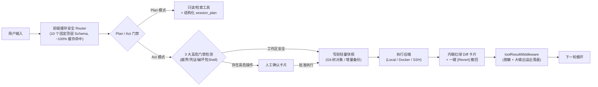

<div align="center">

<picture>
  <source media="(prefers-color-scheme: dark)" srcset="./assets/readme-hero-dark.png" />
  <source media="(prefers-color-scheme: light)" srcset="./assets/readme-hero-light.png" />
  
</picture>

# Aether

### 高确定性 AI 工程工作台。本地优先，拒绝 AI-Slop。

Aether 是一个连接模型实证评测、项目工作区上下文与受控智能体执行的后数字极简主义开发工作台。

前缀缓存安全双层路由 · 二元 Plan/Act 守卫与写前快照一键回退 · 零打扰隐形记忆 · 极简黑白工业风。本地优先数据存储、多模型接入灵活性与纯粹的工程品格，让整个工作流始终完全受控。

[](https://github.com/TQSY114514/Aether/releases)
[](https://github.com/TQSY114514/Aether/releases)
[](https://www.npmjs.com/package/aetherai)
[](https://www.npmjs.com/package/aetherai)
[](https://github.com/TQSY114514/Aether/actions/workflows/ci.yml)
[](./LICENSE)
[](#1-windows-桌面端安装主力形态--强烈推荐)

[English](./README.md) · **[简体中文](./README.zh-CN.md)** · [日本語](./README.ja.md)

</div>

---

## 项目概述

Aether 是一个基于 Electron、React/TypeScript 与 SQLite 构建的本地优先桌面 AI 开发工作台。它的核心思路是把 AI 辅助开发中的关键环节深度连接：在真实任务中评测模型、跨会话保留项目工程上下文，以及通过可审阅的受控 Agent 工作流执行任务。

它围绕五项互补核心能力构建：

1. **任务驱动的模型评测（Arena 2.0）**：让多个模型同屏并排处理同一编码任务，检查各自流式输出，并基于意图分类积累本地 ELO 战力榜与基准；支持胜者补丁一键写入工作区（`arena:apply-patch`）。
2. **多项目工作区中心与三主线导航**：独立管理本地项目，自动追踪 Git 分支与项目规范（`AGENTS.md`），提供系统级文件管理器定位与单项目会话过滤 —— 一级导航收敛为 `Workspace`、`Arena`、`Settings` 三项主线。
3. **前缀缓存安全（Prefix-Cache-Safe）双层工具路由**：固定 10 个顶层常驻工具 Schema（`read_file`, `edit_file`, `write_file`, `grep_search`, `glob_files`, `run_command`, `ask_user`, `session_plan`, `dispatch_subagent`, `call_extended_tool`），杜绝阶段切换导致的 API Prompt Prefix-Cache 抖动（缓存命中率 ~100%）；解耦子代理专属工具池，非核心工具经 `call_extended_tool` 安全网关转发。
4. **二元 Plan / Act 执行门禁与写前快照回退**：砍掉繁琐的 6 轴权限矩阵与频繁弹窗，简化为 `Plan`（只读规划与结构化方案）与 `Act`（工作区内常规读写自动执行零打扰）。每次写操作前后台捕获轻量 Git 树对象 / 增量快照，内联红绿 Diff 卡片并支持右上角一键安全回滚；仅对工作区外越界、敏感凭证（`.env*`, `*.pem`, `*.key`）及高危 Shell 执行人工确认。
5. **AutoMemory 零打扰隐形化与技能蒸馏**：SQLite WAL + FTS5 `< 2ms` 零轮次消耗即时预取。对话头部极简黑白胶囊展示 `[Memory · X hits]`，点击弹出轻量 Popover 查看注入原因（Why Injected），支持一键移除与「Pin 固定到 AGENTS.md」（符号链接防穿越校验）；自动检测重复模式并在对话底部内联提示生成 `SKILL.md`。

Aether 采用本地优先设计：会话、记忆、评测数据和加密后的模型提供商凭据保存在本地 SQLite 数据库中。使用托管模型服务时，发送给服务商的提示词、代码或上下文仍受该服务商的数据处理政策约束。

---

## 快速上手指南

> **推荐首选 Windows 桌面版**：Aether 的核心研发重心与最完整的功能体验（多模型同屏竞技场、可视化记忆图谱、图形化权限与 Diff 审批）均集中在 **Windows 桌面端应用**。除非你处于纯命令行或非 Windows 环境，否则**强烈建议直接下载桌面端安装包**。

### 1. Windows 桌面端安装（主力形态 · 强烈推荐）

前往 [GitHub Releases](https://github.com/TQSY114514/Aether/releases) 下载对应版本：

- **`aetherai-setup-x.y.z.exe`**：标准安装程序（含桌面快捷方式与自动更新支持，**推荐日常首选**）。
- **`aetherai-x.y.z.exe`**：单文件便携版（免安装，双击直接运行）。

> **关于 Windows SmartScreen 提示**：本项目由独立开发者维护，未购买商业代码签名证书。首次运行若遇到系统弹窗提示「Windows 已保护你的电脑」，点击 **更多信息 → 仍要运行** 即可。

### 2. 终端 TUI、无头命令行与 Node SDK（辅助脚本与自动化 · 需 Node.js ≥ 22）

Aether 在 npm 上发布轻量纯净的无头运行时、Ink v5 终端 TUI 与独立 SDK（`aetherai`）：

```bash
# 全局安装 CLI 与 TUI
npm install -g aetherai

# 启动交互式终端 TUI 工作台（支持历史漫游、Diff 预审与回滚）
aether tui

# 在终端中快速续接特定历史会话
aether tui --session 42

# 单次命令执行任务
aether "运行测试套件并修复失败的单元测试" --model deepseek

# 跨模型快速打分评测
aether eval "用 Rust 写一个二分查找" --models claude-3-7-sonnet,deepseek-reasoner

# 启动供外部脚本或子 Agent 接入的 JSONL RPC 守护服务
aether --mode rpc
```

### 3. 首次配置模型提供商

启动应用后，前往侧栏 **设置 → 模型提供商 (Providers)** 添加至少一个 API 接口。Aether 原生支持 OpenAI、Anthropic、Gemini 等协议格式，常见配置如下：

| 接入方式 | 协议格式 | Base URL 示例 | 适用场景说明 |
| :--- | :--- | :--- | :--- |
| **DeepSeek 官方** | OpenAI 兼容 | `https://api.deepseek.com/v1` | 国内直连稳定，日常代码编写与任务处理性价比高 |
| **OpenRouter / 聚合接口** | OpenAI 兼容 | `https://openrouter.ai/api/v1` | 单一密钥可同时调用 Claude、GPT、Gemini、Qwen 等模型，适合用于竞技场对比 |
| **Ollama / LM Studio** | OpenAI 兼容 | `http://127.0.0.1:11434/v1` | 纯本地显卡推理，无需 API Key，支持完全断网环境运行 |

### 4. 从源码构建运行

```bash
git clone https://github.com/TQSY114514/Aether.git
cd Aether

# Windows：自动安装依赖、编译前端并启动 Electron
start.bat

# macOS / Linux：默认进入终端 TUI；附加 --desktop 参数启动桌面 GUI
./start.sh
./start.sh --desktop
```

---

## 核心子系统说明

### 一、 AutoMemory · 结构化长期记忆与项目大脑

Aether 的长期记忆系统基于 SQLite（WAL 模式）、FTS5 全文索引与本地知识图谱（`kg_nodes` / `kg_edges`）构建，而非简单的平面文本或单文件 YAML。它采用 **预取（Prefetch）+ 异步同步（Sync）** 的双通道架构：

- **零延迟上下文预取（Prefetch）**：每次发送消息前，系统在本地数据库中进行关键词与图谱检索（耗时 `< 2ms`），直接将相关记忆拼入本轮上下文，**无需消耗额外的 LLM 工具调用轮次**。
- **后台防抖提炼（Sync）**：每轮对话结束后，后台静默提取新出现的实体、技术决定与用户偏好，经 Jaccard 相似度去重后落盘，不阻塞主对话流。

#### 记忆分类与作用域

| 类型 (`type`) | 作用域与注入策略 | 记录内容示例 |
| :--- | :--- | :--- |
| **`project`（项目大脑）** | 绑定当前工作区目录（Workspace），**每轮固定置顶注入** | 仓库架构约定、构建命令、模块边界、核心技术选型 |
| **`preference`（用户偏好）** | 全局生效，按相关性匹配注入 | 代码风格习惯、回复详略程度、常用语言与框架偏好 |
| **`fact`（客观事实）** | 全局或工作区隔离，按 FTS5 关键词检索注入 | 环境变量位置、服务器端口约定、已确认的业务规则 |
| **`context`（会话摘要）** | 跨会话背景索引 | 阶段性任务进度、长对话压缩后的历史上下文结论 |
| **`review`（待复核项）** | 冲突或待确认条目 | 与既有记忆发生矛盾、需人工裁决保留或覆盖的记录 |

#### 记忆安全与管理特性

1. **`AGENTS.md` 自动发现**：当工作区指向具体代码仓库时，系统自动扫描并注入根目录下的 `AGENTS.md` 或 `AETHER.md` 规范文件。
2. **零打扰隐形化与注入来源透明化（Why Injected）**：记忆管理完全隐形化、零打扰。每轮回复头部以极简黑白胶囊展示 `[Memory · X hits]`，点击弹出轻量 Popover 查看命中条目及具体触发原因（Why Injected），支持一键移除与「Pin 固定到 AGENTS.md」（内置真实路径防越界校验）；当检测到重复工作流时，对话底部内联提示生成 `SKILL.md`。
3. **跨工作区防串味（Fail-Closed Isolation）**：A 项目的工作区记忆严格限制在 A 目录内生效，不会泄漏到 B 项目的对话上下文中。
4. **外部内容降权沙箱（`<untrusted_memory>`）**：由网页抓取或外部工具产生的记忆会自动标记为 `origin='external'`，注入时置于末尾并用 `<untrusted_memory>` 标签隔离，防止间接提示词注入（Indirect Prompt Injection）。
5. **记忆向技能演进（Memory → Skill Bridge）**：支持将高频复用的项目记忆自动聚类，生成可复用的 `SKILL.md` 技能草稿。

---

### 二、 Workspace Hub · 多项目工作区中心与三主线极简布局

Aether 2.0 确立了工作区作为开发的第一公民，彻底解耦跨项目代码污染，消除界面控件冗余散落：

- **收敛至三项主线导航**：一级导航精简为 `Workspace`（主对话 + 内联子代理 Deck + 内联 Diff 回退 + 同屏对比）、`Arena`（同屏多模型实证竞技场）与 `Settings`（统一服务商与 MCP）。
- **侧栏一级工作区中心 (`WorkspaceHeader.tsx`)**：置于侧栏最顶端，提供项目名、仓库识别、一键秒切项目、收藏置顶（⭐）、一键在系统资源管理器中定位（Reveal in Explorer）、一键复制终端 `cd` 路径。
- **Git 状态与规则实时伴随**：自动监测 Git 当前分支与是否有未提交脏文件；识别工作区中生效的项目规则（`AGENTS.md`）。
- **项目会话隔离筛选 (Project Scope Filter)**：支持在会话列表上方一键切换“当前项目专属会话”与“全局会话”，不同工程的会话历史互不干扰。
- **输入框合一 HUD（4 项核心控件）**：精简为 `[Plan / Act 模式]`、`[主模型选择]`、`[思考强度 Effort]`、`[会话 Token/费用与一键快照回退]`。去伪存真，无冗余打架按钮与 AI 营销感发光特效。

---

### 三、 Arena 2.0 · 多模型并发评测与胜者补丁落盘

内置竞技场用于在实际工作负载下量化评估不同模型的表现，并打通从评测到生产落盘的最后一公里：

| 功能模块 | 工作机制 |
| :--- | :--- |
| **同屏并发盲测** | 单条提示词同时下发给 2～4 个选定模型（或同一模型的不同 Temperature / System Prompt），并排流式渲染输出。 |
| **分意图 ELO 计分** | 系统根据提示词自动归类任务意图（`编程 Coding` / `推理 Reasoning` / `翻译写作 Translation`），投票后分别计算各领域的本地 ELO 积分。 |
| **Starter Benchmark 基准套件** | 内置代码生成、算法实现与复杂调试自动化评测套件（`arenaStarterBenchmark.js`），支持一键重跑统计准确率、首字延迟、Token 成本与工具调用成功率。 |
| **胜者补丁一键落盘 (`Winner Patch`)** | 盲测分出胜负后，可直接点击将获胜模型的代码 Diff 无损写入当前本地工作区（`arena:apply-patch`），无需手动复制粘贴。 |
| **报告导出** | 支持将对比结果导出为结构化 Markdown 报告或可视化对比卡片。 |

---

### 四、 二元 Plan / Act 执行门禁与写前快照回退

Aether 彻底告别繁琐的 6 轴权限矩阵与频繁弹窗打断，收敛为果断干脆的 `Plan` / `Act` 二元执行体系，并以即时快照作为安全护城河：

| 模式 | 行为规则 | 适用场景 |
| :--- | :--- | :--- |
| **`Plan`（只读规划模式）** | 禁用一切写文件与状态变更命令；放行项目内代码读取、Grep/Glob 搜索与只读 Git 探路，输出结构化 `session_plan` | 架构探讨、代码走读、改动前方案评估 |
| **`Act`（行动执行模式 · 默认）** | 工作区内部的常规代码搜索、读取、常规编辑与构建测试命令**默认自动执行，不再弹出确认卡片打断流式循环**。每轮 Turn 写操作前后台自动捕获轻量快照（`git stash create` 树对象或 `.aether/snapshots/<turnId>`），内联红绿 Diff 卡片并提供右上角 `[Revert / 一键撤回]` 按钮。 | 日常编码协作、自动化重构与功能实现 |

#### 仅保留 3 种真正高危操作的拦截门禁（Act 模式）

在 `Act` 模式下，仅遇到以下 3 种高危操作时触发人工确认卡片，杜绝误操作风险：
1. **越界访问**：尝试读写项目工作区根目录（Workspace Root）以外的路径；
2. **敏感凭证**：修改敏感凭据文件（`.env*`, `*.pem`, `*.key`）；
3. **破坏性命令**：执行破坏性或高风险 Shell（包含 `rm -rf`, `git reset --hard`, `git push --force`, 或未知外部脚本管道下载执行）。



---

### 五、 自适应思考深度、Hashline 锚定编辑与前缀缓存安全路由

- **5 档自适应思考深度（Thinking Budget）**：在输入框内按回合精细调节推理深度（`minimal 1k`、`low 2k`、`medium 8k`、`high 16k`、`max 32k tokens`），原生兼容以 Token 预算驱动（Claude 3.7 Sonnet、DeepSeek R1、Qwen-Reasoner）与以布尔开关驱动（`enable_thinking`）的主流推理模型。
- **Hashline 哈希锚定代码编辑（Hashline Edits）**：在 `patchEngine.js` 中引入行内容哈希锚定算法，防止多文件或长上下文并发改写时的行号漂移与补丁错位冲突。
- **前缀缓存安全双层路由（Prefix-Cache-Safe Two-Layer Router）**：固定 10 个顶层常驻工具 Schema（`read_file`, `edit_file`, `write_file`, `grep_search`, `glob_files`, `run_command`, `ask_user`, `session_plan`, `dispatch_subagent`, `call_extended_tool`），彻底消除动态增删工具导致的模型 API Prompt Prefix-Cache 失效，缓存命中率提升至 ~100%；多角色子代理（`Explorer`、`Implementer`、`Verifier`）挂载专属工具池，非核心工具通过 `call_extended_tool` 二级安全网关转发。
- **异常自愈机制**：自动清理中断遗留的孤儿 `tool_calls` 记录（防止会话因未闭合的工具调用而永久报错 400）；工具失败时自动触发缩小范围重试（`tryShrinkRetry`）。
- **实时成本与预算熔断**：状态栏实时显示当前迭代步数、单轮预估 Token、累计成本及预算上限，达到阈值时自动暂停 Agent 循环。

---

### 六、 扩展体系：Skills、MCP 与多执行后端

- **Skills（技能包）**：支持导入或编写带有 `permissions:` 权限声明（声明所需文件系统、网络或 Shell 权限）的 `SKILL.md` 模块，与权限引擎联动校验。
- **MCP（Model Context Protocol）**：支持挂载外部 stdio MCP 工具服务器，系统自动为工具添加 `server__tool` 命名空间前缀以防止多服务同名冲突，输出统一经过 `toolResultMiddleware` 脱敏处理。
- **多执行后端（Execution Backends）**：命令与代码执行支持在 **本地进程 (`local`)**、**Docker 容器沙箱 (`docker`)** 与 **远程 SSH 主机 (`ssh`)** 之间切换。

---

## 致谢 (Acknowledgements)

Aether 的架构设计与具体模块实现参考并吸收了以下开源项目与工程先驱的设计思想（按模块溯源）：

### Agent 运行时与编程 Harness
- **[Claude Code](https://claude.ai/code) (Anthropic)** — 级联 `AGENTS.md` 指令发现（`projectInstructions.js`）、压缩后核心文件再水合（`compaction.js`）、自动测试验证闭环（`debugAgent.js`）、10 点生命周期钩子规范（`hooks.js`）、权限阶梯模型（`trustEngine.js`）、`Ctrl+T` 任务面板、`ask_user` 结构化交互及文件修改行内 Diff 预审（`toolImpact.js`）。
- **[OpenAI Codex CLI](https://github.com/openai/codex)** — 基于测试与 Git Diff 证据的验证闭环（`toolLoop.js`）、级联指令发现规范、TUI 紧凑运行计时器、单键权限直达（`y/s/a/n`）与快照回退（`rewind`）交互。
- **[pi (`pi-mono`)](https://github.com/badlogic/pi-mono) (Mario Zechner)** — `AgentMessage` UI 表现层与 LLM 传输层解耦抽象（`agentMessage.js`）、统一事件流遥测架构（`agentEvents.js`）、运行中动态指令转向（`steering.js`）及超大输出落盘 `$TMPDIR` 并返回尾部切片（`toolResultMiddleware.js`）。
- **[OpenCode](https://github.com/sst/opencode)** — 终端 TUI 键盘状态机与 Timed Leader Key（`keyHandlers.js`）、`DialogSelect` 窗口化列表、编译期 Prompt 缓存策略（`cachePolicy.js`）及上下文预算管理器（`contextBudget.js`）。
- **[oh-my-pi (`omp`)](https://github.com/can1357/oh-my-pi) & [roboomp](https://github.com/roboomp)** — 终端 AI 编程 Harness、roboomp 自动化 Triage 与 PR 机器人、哈希锚定代码编辑（`patchEngine.js` 中的 Hashline Edits 防并发冲突与行号漂移）、LSP/DAP 符号级代码智能与多 Worktree 子代理并发编排。
- **[Aider](https://github.com/Aider-AI/aider)** — `<<<<<<< SEARCH ... >>>>>>> REPLACE` 容错补丁解析引擎（`patchEngine.js`）、Git 工作流集成与压缩交接提示词设计。
- **[ZCode](https://github.com/zai-org/ZCode) (Z.ai)** — 8 级级联模糊代码编辑匹配器（`editMatchers.js`）、写前只读时间戳防覆盖哨兵（`sessionContext.js` `readFileState`）、后台任务 `branchGeneration` 隔离与通知批次合并（`backgroundTasks.js`）、内置多 Agent 角色与工作流编排模板（`.aether/agents`、`.aether/workflows`）及 GitHub URL / `owner/repo` 技能一键安装（`skills.js`）。
- **[Gemini CLI](https://github.com/google-gemini/gemini-cli) & [aichat](https://github.com/sigoden/aichat)** — 上下文 Token 预算估算（`contextBudget.js`）、审批模式切换及 50ms 事件流防抖聚合渲染（`runSession.js`）。
- **[Cline](https://github.com/cline/cline)、[Roo Code](https://github.com/RooVetGit/Roo-Code) & [Continue](https://github.com/continuedev/continue)** — 冗余工具输出折叠裁剪（`compaction.js`）、可见子步骤任务追踪与声明式配置即代码规范（`.aether/config.json`）。
- **[Search](https://github.com/driceroland/Search) (`driceroland/Search`)** — 多粒度本地代码仓库检索与上下文感知搜索管线灵感（`registry.js`、`repoMap.js`）。

### 上下文、记忆与安全机制
- **[OpenClaw](https://github.com/openclaw/openclaw)** — 上下文分块压缩算法（`compaction.js`）、工具调用损坏自愈（`toolCallRepair.js`）、只读工具结果缓存（`toolCache.js`）、语义死循环哈希检测（`toolResultHash.js`）及工具输出脱敏截断中间件（`toolResultMiddleware.js`）。
- **[Hermes Agent](https://github.com/NousResearch/hermes-agent)** — 迭代预算控制与优雅收尾机制（`iterationBudget.js`）、SQLite + FTS5 长期记忆（`autoMemory.js`）、本地实体关系图谱（`knowledgeGraph.js`）、长对话轨迹压缩（`trajectory.js`）及长效技能习得（`habitLearner.js`）。
- **[Wish](https://github.com/WindustH/wish-core) (WindustH)** — Prompt Cache 零损耗的按需 CLI 桥接架构、Windows Win32 Job Object 内核级进程树沙箱治理与基于 Fetch 的高韧性流状态机。
- **[DeepSeek Harness (DSH)](https://github.com/deepseek-ai/deepseek-harness)** — 本地网关回环绑定与 HTTP Host 头安全校验实践（QVD-2026-57410 防御参考）及 README 徽章视觉规范。
- **[Open Math Harness](https://github.com/openmathmodel/open-math-harness) (SAIR Foundation)** — 微内核架构不变量守卫与无头隔离规范（借鉴 `architecture.rs` 静态分析思想落地 `check-architecture.js` 5 重架构门禁与无头模式下 `database.js` Electron 依赖解耦）。

### 评测、代码审查与多 Agent 编排
- **[Qwen Code](https://github.com/QwenLM/qwen-code) & [Qwen-Coder](https://github.com/QwenLM/Qwen3-Coder)** (Alibaba Cloud) — Agent Arena 多模型并行竞技场与 Git Worktree 隔离执行机制（`/arena` 启发 `shadowGit.js` 与 `arena:apply-patch`）、`qwencoder-eval` 评测基准思想及思考参数自适应（`enable_thinking` 融入 `reasoning.js`）。
- **[LMSYS Chatbot Arena](https://chat.lmsys.org/) & [SWE-bench](https://www.swebench.com/)** — 内置本地模型双盲竞技场（`arena.handler.js`）、成对盲测 ELO 积分排名与代码能力自动化基准体系。
- **[Paperclip](https://github.com/paperclipai/paperclip)** — Agent 运行时控制平面治理设计（`AgentSettings.tsx`）、多 Agent 角色权限隔离与交叉验证机制（`securityAudit.js` 中 `Hunter != Verifier`、`agentRoles.js`）及计划步骤自动推进（`planning.js`）。
- **[OpenHands](https://github.com/All-Hands-AI/OpenHands) (All-Hands AI)** — 多执行后端抽象（`backend.js`、`dockerBackend.js`、`sshBackend.js`）与全自主 Sandbox 隔离执行工作流。
- **[Jules](https://jules.google.com)** (Google Labs)、**[Grok Build](https://x.ai)**、**[Amp](https://ampcode.com)** & **[Devin Desktop (Windsurf)](https://windsurf.com)** — 异步后台编码 Agent、专门化子 Agent 角色划分（`agentRoles.js`）、长程任务执行状态机（`longRunningTask.js`）与运行时间线抽屉灵感。
- **[Kiro](https://aws.amazon.com/q/developer/)** — 推理深度多档位自适应控制（`reasoning.js` / `EffortControl.tsx`）与行内子代理执行视图（`SubagentDeck.tsx`）。
- **[DS4](https://gist.github.com/antirez) (Salvatore Sanfilippo)** & **[Evolver](https://github.com/EvoMap/evolver)** — 执行前层次化任务分解（`planning.js`）与基因组进化协议 (GEP) 策略反思架构。
- **[CodeRabbit](https://coderabbit.ai) & [Greptile](https://greptile.com) ([`greptile-apps[bot]`](https://github.com/apps/greptile-apps))** — 自动化 PR 逐行代码审查、AST/上下文感知高危 API 拦截（`.coderabbit.yaml`）与全仓库架构级语义图谱回归防御。

### 核心基础设施与 UI 生态
- **运行时与存储底座**：[Electron](https://www.electronjs.org) · [better-sqlite3](https://github.com/WiseLibs/better-sqlite3) (Joshua Wise) · [Ink v5](https://github.com/vadimdemedes/ink) (Vadim Demedes) · [React](https://react.dev) · [Zustand](https://github.com/pmndrs/zustand) (Poimandres) · [Tailwind CSS](https://tailwindcss.com)。
- **组件与协议设计**：[Model Context Protocol (MCP)](https://modelcontextprotocol.io) · [shadcn/ui](https://github.com/shadcn-ui/ui) · [Magic UI](https://github.com/magicuidesign/magicui) · [cc-switch](https://github.com/farion1231/cc-switch) · [new-api](https://github.com/QuantumNous/new-api)。

---

## 参与贡献与许可

- **问题反馈与功能建议**：请提交至 [GitHub Issues](https://github.com/TQSY114514/Aether/issues/new)。
- **开发规范**：提交代码前请查阅 [CONTRIBUTING.md](./CONTRIBUTING.md)、[AGENTS.md](./AGENTS.md) 与 [docs/roadmap.md](./docs/roadmap.md)。
- **开源协议**：[MIT](./LICENSE)（第三方开源组件声明见 [THIRD-PARTY-NOTICES.md](./THIRD-PARTY-NOTICES.md)） © 2025-2026 Aether
