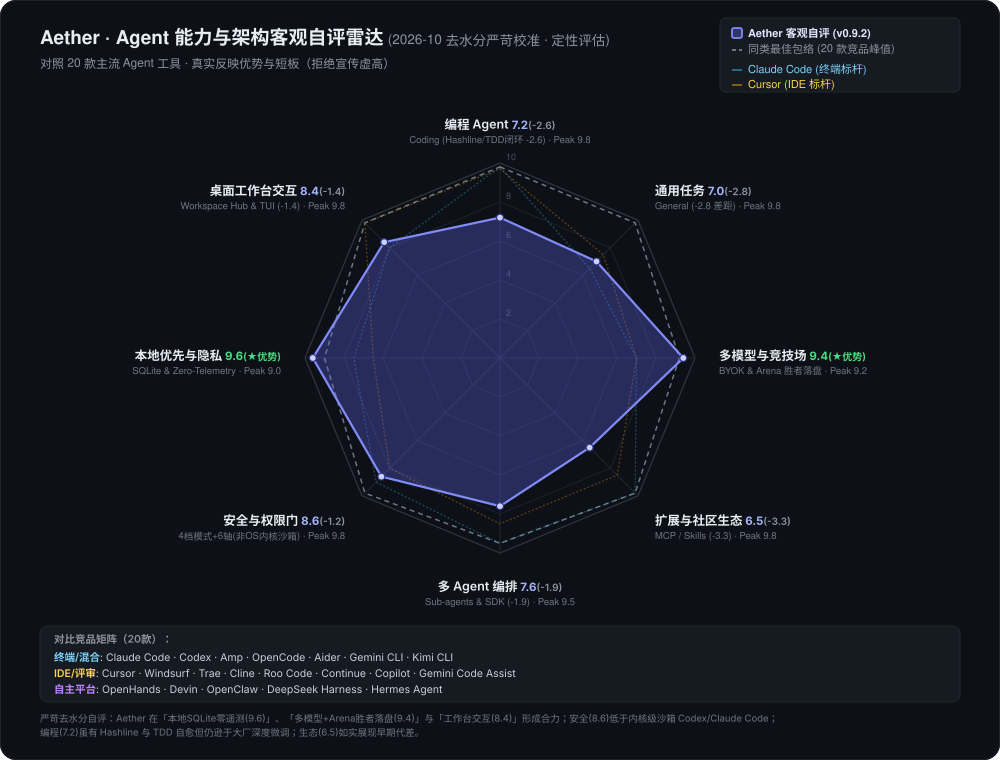

# Aether 竞品调研与客观能力画像（2026-09 严苛去水分版）

> 本文为 **Aether 与 20+ 款主流 AI Agent 工具的架构对比与客观自评报告**。
> **核心原则：拒绝宣传虚高**。所有评分均以实际已落地的代码能力与真实工程边界为准——凡是未实现（如 AST Repo Map、浏览器视觉闭环、OS 内核级强制沙箱）或处于早期阶段（如开源社区生态）的维度，一律如实扣分。

---

## 1. 评分维度与衡量标准（1–5 分制 & 雷达图 10 分制）

| 维度 | 雷达图对应轴 | 严格评分依据（什么情况能拿高分，什么情况必须扣分） |
| :--- | :--- | :--- |
| **编程 Agent 深度** (`Coding`) | 编程 Agent (`Coding`) | AST/Tree-sitter 仓库索引、LSP 语义诊断、多文件精准重构、专用 Fast-Apply 模型。缺 AST 拓扑图或无专有补全模型须扣分。 |
| **通用任务自主性** (`Autonomy`) | 通用任务 (`General`) | 长链路工具循环、故障恢复、浏览器 DOM/视觉操作、OS 级桌面控制。缺浏览器视觉闭环或云端长程虚拟机须扣分。 |
| **多模型与评测** (`Multi-model & Eval`) | 多模型与竞技场 | 可接入供应商广度（OpenAI / Anthropic / Gemini / DeepSeek / Ollama）、BYOK 零锁定、内置 Arena 盲测与按意图 ELO 统计。 |
| **扩展与社区生态** (`Extensibility & Eco`) | 扩展与社区生态 | MCP 挂载、SKILL.md、生命周期 Hooks、插件市场易用度，以及真实的 GitHub 社区体量（Star / Contributor / 第三方包数量）。 |
| **多 Agent 编排** (`Multi-agent`) | 多 Agent 编排 | 子 Agent 派生、角色权限隔离、后台队列持久化、双模型对抗复核（Runner-Up Review）。 |
| **安全与权限门** (`Safety`) | 安全与权限门 | 细粒度能力轴门禁、行内 Diff 预审、输出脱敏、防间接注入。**若默认本地执行缺乏 OS 内核级强制沙箱（如 Seatbelt / seccomp / AppContainer），上限不得超过 4.2 (8.4/10)**。 |
| **本地优先与隐私** (`Local-first`) | 本地优先与隐私 | 会话/记忆/图谱/配置 100% 本地 SQLite 落盘、零遥测、无需注册云端账号、支持断网 Ollama 运行、本地密钥系统级加密。 |
| **桌面工作台交互** (`Desktop UX`) | 桌面工作台交互 | 是否提供直观实用的桌面独立工作台界面（实时流式思考、BTW 只读抽屉、任务队列、多模型同屏盲测对战），但与深度嵌入 IDE 源码补全环境（如 Cursor/Windsurf）相比仍有定位区隔。 |

---

## 2. 全景自评雷达图（基于 `app/scripts/gen-radar.cjs` 生成）

  

### 为什么 Aether 的雷达图呈现明显的「横向凸出、上下凹陷」？

我们刻意不画一个“八边形全满”的宣传图。这张图的不对称形状直接反映了项目的真实工程取舍：

1. **左右两翼突出（`本地隐私 9.6` · `多模型与竞技场 9.4`）**：
   Aether 从第一天起就拒绝做单模型套壳或云端中转，所有数据存在本机 `aetherai.db`（WAL 模式），并在客户端内原生集成了多模型并发盲测、Starter 基准测试套件与胜者补丁单键落盘。这两项是代码库已扎实落地的核心差异点。
2. **左下与左上中规中矩（`安全与权限门 8.6` · `桌面工作台交互 8.4`）**：
   Aether 实现了 4 阶运行模式（`explore` / `workspace` / `auto_review` / `unrestricted`）、6 轴权限门、动态高危 `ALWAYS_ASK` 拦截、Win32 Job Object 内核进程树治理、`toolResultMiddleware` 密钥脱敏与可选 Docker 沙箱，防护水平高于绝大多数直接裸跑 Shell 的开源客户端；但由于 Windows 默认 `localBackend` 仍运行在用户态进程而非 OS 内核沙箱（对比 Codex CLI `9.8` 的 Seatbelt/Landlock 与 Claude Code `9.0`），因此客观定为 `8.6`；独立桌面工作台（`8.4`）具备一级 Workspace 枢纽、5 阶思考预算调优、沉浸式思考流、BTW 抽屉与排队甲板，且支持轻量终端 Ink TUI（`aether tui`），但不及 Cursor (`9.8`)、Windsurf (`9.6`) 的深度 IDE 编辑器集成。
3. **顶部与右下如实凹陷（`编程 Agent 7.2` · `多 Agent 7.6` · `通用任务 7.0` · `扩展与生态 6.5`）**：
   虽然落地了 Hashline 防漂移编辑与 TDD 自动审查回环，单一编程补全深度仍不及百人专有团队的 Claude Code (`9.8`) 与 Cursor (`9.7`)；多 Agent（`7.6`）支持任务日志、崩溃恢复与子代理编排，但集群规模不及云端调度平台；同时项目处于开源发展阶段，社区生态体量较小，因此合并扩展与生态后如实给到 `6.5`。

---

## 3. 20 款主流 Agent 工具评分总表（5 分制明细）

| 工具 | 形态分类 | 编程深度 (`Coding`) | 通用自主 (`General`) | 多模型自由度 (`Multi-model`) | 内置评测 (`Evaluation`) | 安全与权限 (`Safety`) | 本地隐私 (`Local-first`) | 终端体验 (`Terminal UX`) | 桌面/IDE (`Desktop UX`) | 社区与生态 (`Ecosystem`) |
| :--- | :--- | :---: | :---: | :---: | :---: | :---: | :---: | :---: | :---: | :---: |
| **Aether (v0.9.2)** | **桌面为主工作台 + Headless CLI** | **3.6** | **3.5** | **4.7** | **4.7** | **4.3** | **4.8** | **2.8** | **4.2** | **1.5** |
| Claude Code | 终端 Agent 标杆 | 4.9 | 3.3 | 1.5 | 2.0 | 4.5 | 3.5 | 5.0 | 3.0 | 5.0 |
| Codex CLI | 终端沙箱 Agent | 4.8 | 4.0 | 2.0 | 2.0 | 4.9 | 3.5 | 4.5 | 3.0 | 4.2 |
| Amp (`ampagent`) | 终端/云端混合 | 4.7 | 3.8 | 3.5 | 3.5 | 4.4 | 2.5 | 4.5 | 4.5 | 4.0 |
| OpenCode | 终端 TUI Agent | 4.6 | 3.4 | 4.6 | 2.0 | 4.2 | 4.5 | 4.8 | 2.0 | 4.2 |
| Aider | 终端 Git Agent | 4.6 | 3.2 | 4.5 | 3.0 | 4.0 | 4.4 | 4.2 | 1.0 | 4.5 |
| Gemini CLI | 终端 Agent | 4.2 | 4.1 | 2.0 | 2.0 | 4.3 | 4.0 | 4.0 | 2.0 | 4.2 |
| Kimi CLI | 终端 Agent | 4.3 | 3.8 | 1.5 | 2.0 | 4.0 | 3.5 | 4.0 | 1.0 | 2.8 |
| Cursor | 专有 AI IDE 标杆 | 4.9 | 3.8 | 3.8 | 3.0 | 4.0 | 2.5 | 2.5 | 4.9 | 5.0 |
| Gemini Code Assist | IDE / PR 审查 | 4.5 | 4.2 | 2.0 | 3.0 | 4.4 | 2.0 | 2.0 | 4.4 | 4.5 |
| Devin Desktop (Windsurf) | 专有 AI IDE | 4.7 | 3.6 | 3.5 | 3.0 | 4.0 | 2.5 | 2.5 | 4.8 | 4.2 |
| Trae | 专有 AI IDE | 4.6 | 3.8 | 3.5 | 2.0 | 4.0 | 2.5 | 2.0 | 4.7 | 3.8 |
| Cline | VS Code 插件 | 4.5 | 3.6 | 4.4 | 2.0 | 4.1 | 4.2 | 1.5 | 4.4 | 4.5 |
| Roo Code / Kilo Code | VS Code 插件 | 4.7 | 3.9 | 4.5 | 2.5 | 4.2 | 4.3 | 1.5 | 4.4 | 4.4 |
| Continue | IDE 插件 + CLI | 4.5 | 3.6 | 4.5 | 2.5 | 4.0 | 4.4 | 3.5 | 4.2 | 4.5 |
| GitHub Copilot | IDE 插件 / 平台 | 4.4 | 3.5 | 3.2 | 2.0 | 4.1 | 1.5 | 3.0 | 4.7 | 5.0 |
| OpenHands | 容器化全自主平台 | 4.6 | 4.2 | 4.2 | 4.2 | 4.6 | 4.2 | 3.5 | 3.8 | 4.4 |
| Devin | 云端全自主工程师 | 4.8 | 4.3 | 1.5 | 3.0 | 4.2 | 1.5 | 1.5 | 4.4 | 3.8 |
| OpenClaw | 开源自主框架 | 3.8 | 4.9 | 4.2 | 2.0 | 3.5 | 4.5 | 3.8 | 3.0 | 3.5 |
| DeepSeek Harness (DSH) | 插件化开源引擎 | 4.5 | 4.4 | 3.5 | 2.0 | 3.2 | 4.0 | 3.8 | 2.5 | 4.2 |
| Hermes Agent | 记忆与自演进框架 | 4.4 | 4.5 | 4.4 | 2.5 | 4.1 | 4.4 | 3.8 | 2.5 | 3.6 |

---

## 4. Aether 当前真实的工程长板与客观短板

### 4.1 已落地的四项真实长板

1. **纯本地 SQLite 存储与可解释长期记忆 (`Local-first 4.8 / 5`)**
   - 会话、任务计划（`session_plan`）、结构化记忆（`memory` + FTS5 全文检索）与实体关系图谱（`kg_nodes` / `kg_edges`）全部保存在本机 SQLite（WAL 模式）。
   - 采用双通道 `< 2ms` 内存缓存预取（Prefetch），无需消耗额外 LLM 工具调用轮次；严格按工作区（Workspace）做 Fail-Closed 隔离，防止跨项目记忆污染。
2. **多模型自由接入 + 内置 Arena 盲测与胜者落盘 (`Multi-model 4.7` + `Evaluation 4.7`)**
   - 兼容 OpenAI、Anthropic、Gemini、DeepSeek、OpenRouter 与本地 Ollama。
   - 内置可视化模型竞技场（并发盲测、按编程/推理/写作分别统计本地 ELO、Starter 基准测试套件重跑、胜者代码补丁一键落盘 `arena:apply-patch`、亚军模型对抗复核 `Runner-Up Review`）。
3. **五层应用级安全防护 (`Safety 4.3 / 5`)**
   - 6 轴能力权限门（`READ` / `WRITE` / `EXECUTE` / `NETWORK` / `GIT` / `EXTERNAL`）+ 四档运行模式（`explore` / `workspace` / `auto_review` / `unrestricted`）；
   - 高危操作（触碰 `.env`、删除文件、`npm install`）动态强制升级为 `ALWAYS_ASK` 审批，配合行内红绿 Diff 预览；
   - `toolResultMiddleware` 自动掩码脱敏输出中的密钥，外部记忆强制包裹 `<untrusted_memory>` 防御间接提示词注入，Win32 Job Object 内核进程树治理，支持切换至 Docker 容器沙箱后端（`dockerBackend.js`）。
4. **Windows 桌面端为主、跨平台终端 TUI 协同 (`Desktop 4.2` + `Terminal 2.8`)**
   - 桌面端具备一级 Workspace 枢纽、5 阶思考深度控制与单权威消重主页；终端 `aether tui`（Ink v5）读写同一份本地数据库，支持 `aether tui --session <id>` 跨端续接同一会话。

### 4.2 坦诚公开的四项客观短板（为什么我们在这些维度主动扣分）

1. **单模型编程上限不及专用 AI IDE (`Coding 3.6 / 5`)**：
   - Aether 是独立工作台而非代码编辑器（无内置 Monaco 全量编辑生态，也无 Cursor 的专有 Fast-Apply 小模型）。尽管已落地 Hashline 防漂移编辑与 TDD 自动审查回环，代码搜索主要依赖 `grep_search` / `glob_find` 与阶段路由，基于 Tree-sitter AST 的压缩仓库拓扑图（`Repo Map`）仍在规划中。
2. **默认本地执行缺乏 OS 内核级强制沙箱 (`Safety 4.3 / 5`，低于 Codex `4.9` / Claude Code `4.5`)**：
   - 尽管 Aether 提供了 Win32 Job Object 进程树管控、可选的 Docker 容器后端与完善的权限门，但在用户未安装 Docker、使用默认 `localBackend` 时，子进程仍以当前 Windows 登录用户权限运行，未启用类似 macOS Seatbelt 或 Linux Landlock 的操作系统内核级强制隔离。
3. **缺乏浏览器视觉与桌面 GUI 自动化闭环 (`General 3.5 / 5`)**：
   - 目前 Agent 工具链聚焦于文件系统、命令行与 HTTP 抓取，尚未内置 Headless 浏览器 DOM/渲染自检或键鼠屏幕控制（Computer Use）。
4. **早期项目的社区与插件市场生态薄弱 (`Ecosystem 1.5 / 5`)**：
   - 底层雖已支持 MCP stdio 与 `SKILL.md`，但 GUI 内置的「一键安装 MCP 插件市场」尚未上线，且作为早期个人开源项目，社区规模与主流项目存在数量级差距。

---

## 5. 架构吸收与致谢溯源

Aether 在研发过程中研究了上述 20+ 款工具的源码与设计文档，具体借鉴与防御对照如下：

| 借鉴来源 | Aether 落地模块与具体吸收内容 |
| :--- | :--- |
| **Claude Code** | 验证闭环（`debugAgent.js`）、10 点生命周期钩子（`hooks.js`）、权限阶梯（`trustEngine.js`）、`Ctrl+T` 任务清单面板、`ask_user` 结构化提问与文件行内 Diff 预审。 |
| **OpenClaw** | 上下文智能压缩算法（`compaction.js`）、工具结果脱敏与截断中间件（`toolResultMiddleware.js`）、工具调用损坏自动修复（`toolCallRepair.js`）、只读工具缓存（`toolCache.js`）与语义死循环检测（`toolResultHash.js`）。 |
| **Hermes Agent** | 迭代预算控制与优雅收尾（`iterationBudget.js`）、SQLite + FTS5 长期记忆（`autoMemory.js`）、实体关系知识图谱（`knowledgeGraph.js`）、轨迹压缩（`trajectory.js`）与技能习得（`habitLearner.js`）。 |
| **OpenCode** | 终端 TUI 键盘状态机与 Timed Leader Key（`keyHandlers.js`）、`DialogSelect` 垂直无闪烁列表、请求编译期 Prompt 缓存策略（`cachePolicy.js`）与上下文预算管理（`contextBudget.js`）。 |
| **pi (`pi-mono`)** | `AgentMessage` 表现层与传输层消息解耦（`agentMessage.js`）、统一事件流遥测（`agentEvents.js`）及运行中实时指令转向（`steering.js`）。 |
| **ZCode** | 后台任务 `branchGeneration` 隔离与通知防抖聚合（`backgroundTasks.js`）、Prompt Cache 系统块排序与零 LLM 成本本地微压缩（`microcompact.js`）、多策略代码编辑匹配器（`editMatchers.js`）。 |
| **OpenAI Codex CLI** | 基于测试与 Diff 证据的验证闭环（`toolLoop.js`）、TUI 紧凑计时器与帧合并调度（`runSession.js`）、单键审批直达（`y/s/a/n`）与检查点回退心智。 |
| **Aider** | `<<<<<<< SEARCH ... >>>>>>> REPLACE` 容错补丁解析引擎（`patchEngine.js`）、Git 自动检查点与回滚流、上下文压缩交接提示词框架。 |
| **Cline / Roo Code** | 上下文冗余输出折叠裁剪（`compaction.js`）与可见子步骤任务追踪心智。 |
| **Gemini CLI & aichat** | 令牌预算估算（`contextBudget.js`）、审批模式循环切换及 `aichat` 50ms 事件流聚合防闪烁机制（`runSession.js`）。 |
| **DeepSeek Harness (DSH)** | 吸取其本地监听安全教训（QVD-2026-57410），严格绑定 `127.0.0.1` 回环地址并校验 HTTP Host 头防御 DNS Rebinding。 |
| **Qwen Code** | Agent Arena 多模型并行竞技场与 Git Worktree 隔离执行机制（`/arena` 启发 `shadowGit.js` 影子工作区隔离、多模型并行分发与 `arena:apply-patch` 胜者补丁落盘）、思考参数自适应（`enable_thinking` 融入 `reasoning.js`）及长程代码基准规范。 |
| **Open Math Harness** | 微内核架构不变量守卫与无头隔离规范（借鉴 `architecture.rs` 静态分析思想落地 `check-architecture.js` 5 重架构门禁、无头模式下 `database.js` Electron 依赖解耦及基于真值裁决器的有界树搜索验证）。 |
| **LMSYS Chatbot Arena & SWE-bench** | 本地双盲竞技场（`arena.handler.js`）、动态 ELO 积分排名与代码能力自动化基准体系。 |
| **OpenHands** | 多执行后端抽象（`backend.js`、`dockerBackend.js`、`sshBackend.js`）与全自主 Sandbox 隔离执行工作流。 |
| **Kiro** | 推理深度多档位自适应控制（`reasoning.js` / `EffortControl.tsx`）与行内子代理执行视图（`SubagentDeck.tsx`）。 |
| **Wish (wish-core / wish-web)** | Prompt Cache 零损耗的按需 CLI 桥接设计、Windows Win32 Job Object 内核级进程树生命周期沙箱、基于 Fetch 的高韧性指数退避 SSE 流状态机与长会话 Compaction 三维水位线。 |
| **Paperclip** | Agent 运行时控制平面治理设计（`AgentSettings.tsx`）、多 Agent 角色权限隔离与交叉验证机制（`securityAudit.js` 中 `Hunter != Verifier`、`agentRoles.js`）及计划步骤自动推进与完成态终态闭合机制（`planning.js`）。 |
| **Search** (`driceroland/Search`) | 多粒度本地代码仓库检索与上下文感知搜索管线灵感（`registry.js`、`repoMap.js`）。 |
| **DS4** (Salvatore Sanfilippo) | 执行前层次化任务分解与规划思想（`planning.js`）。 |
| **Evolver** | 基因组进化协议 (GEP) 策略反思架构。 |
| **Jules** (Google Labs) | 全自主异步后台编码 Agent、基于安全云沙箱的端到端 Issue-to-PR 闭环及多任务并发托管架构。 |
| **oh-my-pi (`omp`) & roboomp** | 终端 AI 编程 Harness、roboomp 自动化 Triage 与 PR 机器人、哈希锚定代码编辑（`patchEngine.js` 中的 Hashline Edits 防并发冲突与行号漂移）、LSP/DAP 符号级代码智能与多 Worktree 子代理并发编排。 |
| **CodeRabbit & Greptile** | 自动化 PR 逐行代码审查、AST/上下文感知高危 API 拦截（`.coderabbit.yaml`）与全仓库架构级语义图谱回归防御。 |
